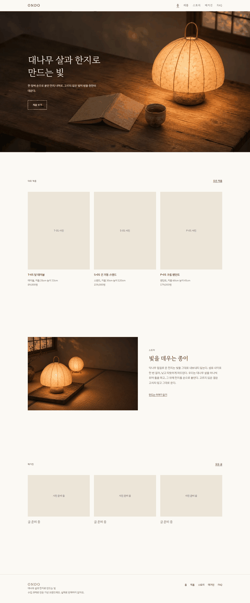
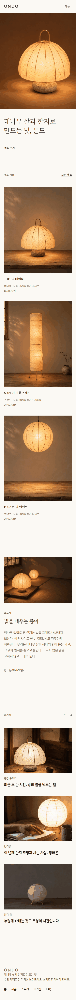

# 작품 게시: 홈

- **페이지:** 홈 (`pages/home/`)
- **만든 사람:** 상경 (어)
- **배포 주소:** (Render 배포 후 추가)
- **한 줄 소개:** 불 켜진 한지 등 사진으로 브랜드 분위기를 먼저 느끼고, 대표 제품, 스토리, 매거진으로 넘어갈 수 있다.

## 화면

| 데스크톱 | 휴대폰 (375px) |
| --- | --- |
|  |  |

## 만든 것
- [x] 첫 화면: 불 켜진 조명 사진, 제목 "대나무 살과 한지로 만드는 빛, 온도", 제품 보기 링크. 열면 앞 문장 → "온도" → 제품 보기 순서로 스르르 나타난다 (소개 문장은 덜어냄)
- [x] 대표 제품 3개, 누르면 제품 페이지로 (카드 사진은 홈에서 임시로 넣음)
- [x] 스토리 맛보기
- [x] 최신 매거진 글 3개, 누르면 그 글로

## 왜 이렇게 만들었나
- Akari 판매 페이지처럼 여백이 넓고 사진이 주인공인 레퍼런스 배치를 참고해서 만들었다.
- 첫 화면은 글을 덜어내고 제목 한 줄과 링크 하나만 남겼다. 글자가 차례로 천천히 나타나게 해서 불이 켜지는 느낌을 냈다.
- 색, 글꼴, 여백은 DESIGN.md 시안 v3 값을 따랐다.

## Claude와 어떻게 만들었나
- 맡긴 일: 홈 페이지 배치와 코드, DESIGN.md 값 적용, 사진 변환(WebP, 300KB 이하), 데스크톱과 휴대폰 폭 캡처로 확인
- 내가 고친 일: 첫 화면 높이와 사진 잘림, 제목 문구와 크기, 위치, 나타나는 순서와 속도, 제품 보기 버튼 모양을 화면을 보며 하나씩 정했다
- 쓴 요청문: "design.md만 따라서 해줘 우선", "대나무 살과 한지로 만드는 빛,까지 한번에 디졸브, 그 다음에 시간차를 두고 온도 글자가 뒤따라 디졸브로 나올 수 있게 해줘"

## 사진, 글 출처
| 파일 | 출처 |
| --- | --- |
| `pages/home/images/hero-dome.webp` (첫 화면) | ChatGPT 이미지 생성 |
| `images/concept/concept-T-01-T-02.webp` (스토리 맛보기) | ChatGPT 이미지 생성 |
| `images/products/<코드>-on.webp` (대표 제품) | ChatGPT 이미지 생성 (정연 제품 사진) |
| 매거진 사진, 제목 | 지영의 매거진 페이지 (`pages/magazine/`) |
| 스토리 단락 | Claude가 쓴 임시 문구 |

## 남은 일
- 스토리 단락을 내 말투로 다시 쓰기
- 대표 제품 사진: 공통 `ondoProductCard`가 사진을 넣게 되면(정연) 홈의 임시 코드 지우기
- `common/style.css`에 DESIGN.md가 반영됐으니(#44) 홈 안의 덮어쓰기 블록 지우기
- 매거진에 새 글이 생기면 홈의 최신 3개를 손으로 바꾸기 (지영이 알려 줌)
- 다음 배치 실험: 두 칸 첫 화면, 엇갈린 제품 배치
